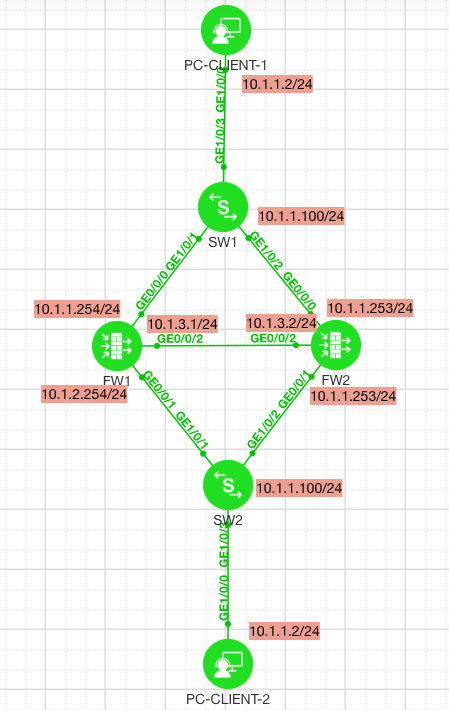

:::Description
华为USG系列防火墙VRRP + HRP实验
:::

> Lab Toplogy


#### FW

```
firewall zone trust
 set priority 85
 add interface GE0/0/1
 add interface GE0/0/9
#
firewall zone untrust
 set priority 5
 add interface GE0/0/0
#
firewall zone dmz
 set priority 50
 add interface GE0/0/2
#
interface GE0/0/0
 ip address 10.1.1.254 255.255.255.0
 vrrp vrid 1 virtual-ip 10.1.1.250 active
#
interface GE0/0/1
 ip address 10.1.2.254 255.255.255.0
 vrrp vrid 1 virtual-ip 10.1.2.250 active
#
interface GE0/0/2
 ip address 10.1.3.1 255.255.255.0
#
hrp authentication-key zaq12wsx
hrp interface GE0/0/2 remote 10.1.3.2
hrp enable
#
security-policy
 rule name permit-icmp
  source-zone trust
  destination-zone untrust
  source-address 10.1.2.0 mask 255.255.255.0
  destination-address 10.1.1.0 mask 255.255.255.0
  service icmp
  action permit
```
