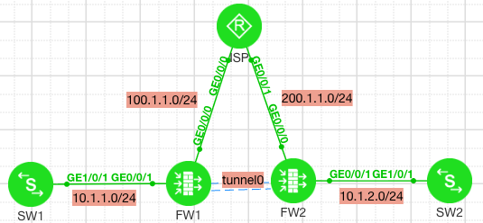
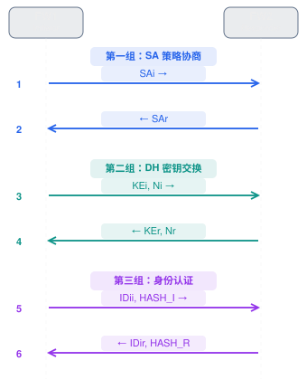

:::Description
华为USG系列防火墙IPSec
:::

> Lab Toplogy


## IKE

### IKE Phase1(主模式)

第一阶段的目标是：让两个 VPN 网关相互信任，并建立一个受保护的协商通道



#### 第一组：消息 1、2 — 安全策略协商

***Message 1：FW1 → FW2***
FW1 向 FW2 发送自己支持的 IKE 安全策略，例如：

```
Encryption: AES-256
Hash:       SHA-256
Auth:       Pre-Shared Key
DH Group:   14
Lifetime:   86400
```

***Message 2：FW2 → FW1***
FW2 从 FW1 提供的策略中选择双方都支持的一套，并返回选中的策略。
此时双方达成一致：使用什么算法来保护后续 IKE 通信。

#### 第二组：消息 3、4 — DH 密钥交换

***Message 3：FW1 → FW2***
FW1 发送：

- KEi：自己的 Diffie-Hellman 公共交换值
- Ni：自己生成的随机数 Nonce

***Message 4：FW2 → FW1***

FW2 发送：

- KEr：自己的 Diffie-Hellman 公共交换值
- Nr：自己生成的随机数 Nonce
双方利用 DH 算法分别计算出相同的共享秘密，并结合随机数及认证方式派生 IKE 所需的密钥材料。
双方不会直接在网络上传输共享秘密或 PSK。

#### 第三组：消息 5、6 — 身份认证

***Message 5：FW1 → FW2***

FW1 发送经过加密保护的：

- IDii：发起方身份标识
- HASH_I：使用协商出的密钥材料等计算的认证哈希值（PSK 认证场景）
FW2 使用对应信息验证 FW1 的身份。

***Message 6：FW2 → FW1***

FW2 返回经过加密保护的：

- IDir：响应方身份标识
- HASH_R：响应方计算的认证哈希值
FW1 验证 FW2 的身份。

验证成功后，双方完成双向身份认证，IKE SA 正式建立
