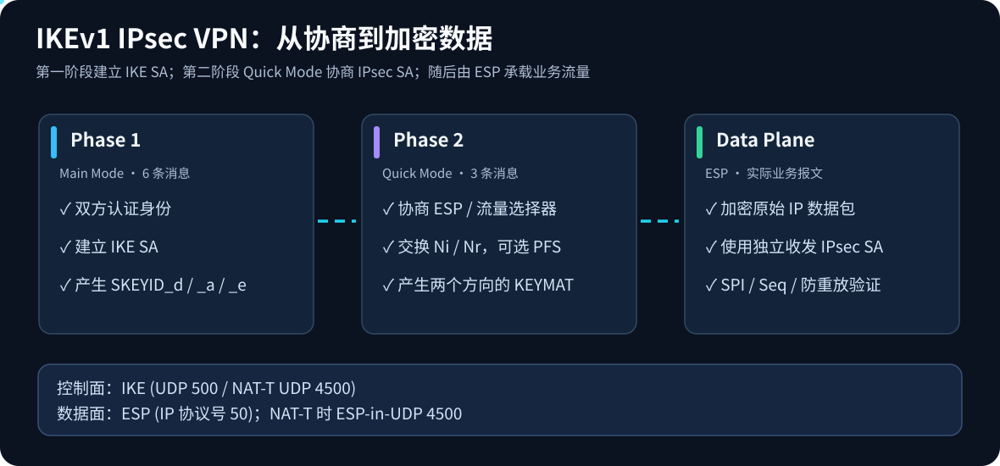
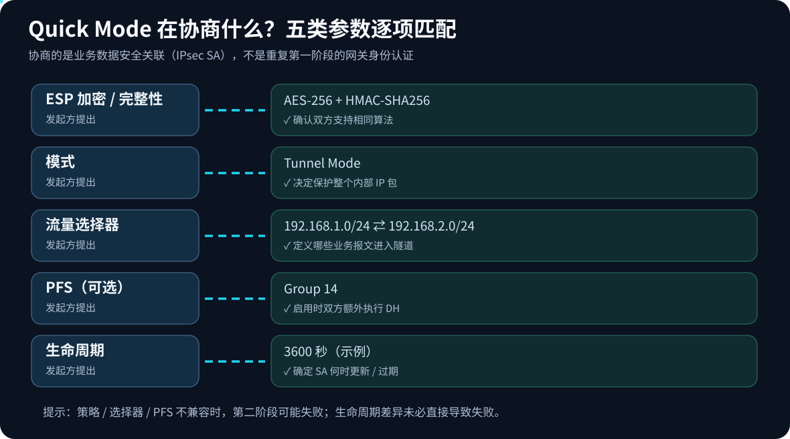
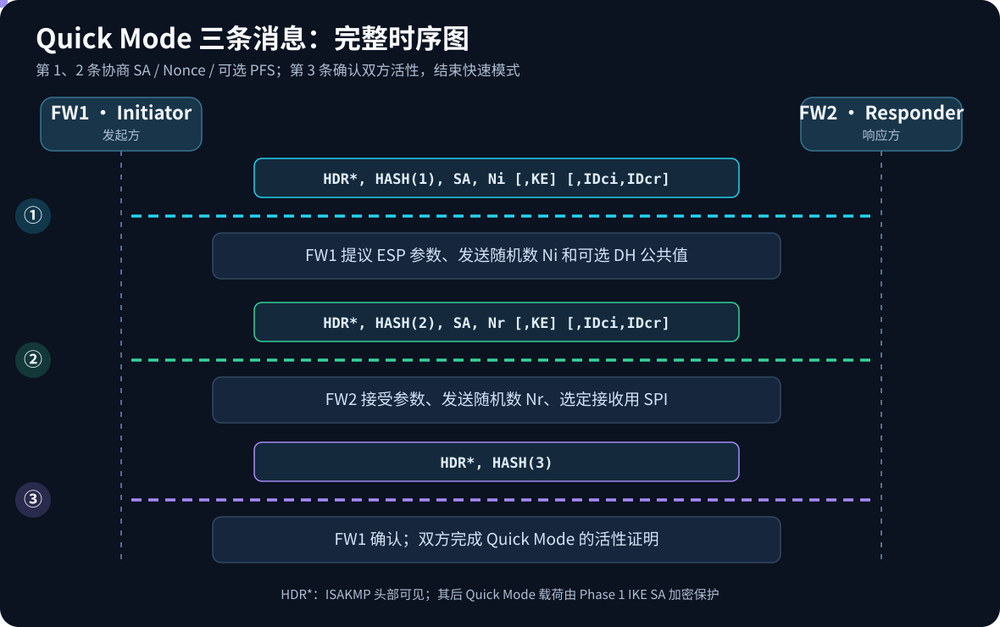
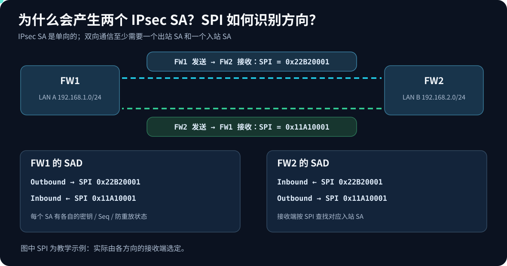
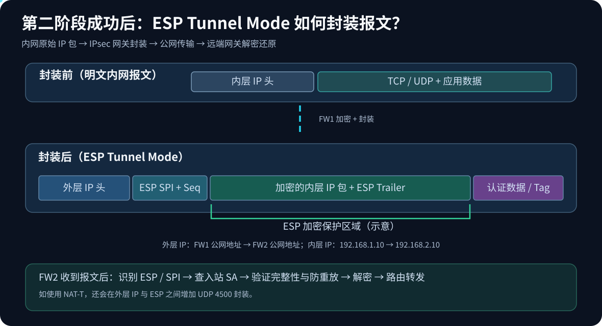

> 📖 本文以华为 USG 系列防火墙为背景，梳理 IKEv1 两阶段协商与 IPsec 业务转发流程。

---

## 🧭 IKEv1 协商概览

IKEv1 分为两个阶段：第一阶段建立 IKE SA，第二阶段协商用于保护业务流量的 IPsec SA。



---

## 🔐 第一阶段：主模式（Main Mode）

> 🎯 **阶段目标：** 让两个 VPN 网关相互信任，并建立一个受保护的协商通道。


### 📋 消息 1、2：安全策略协商

**消息 1：FW1 → FW2**

FW1 向 FW2 发送自己支持的 IKE 安全策略，例如：

```text
Encryption: AES-256
Hash:       SHA-256
Auth:       Pre-Shared Key
DH Group:   14
Lifetime:   86400
```

**消息 2：FW2 → FW1**

FW2 从 FW1 提供的策略中选择双方都支持的一套，并返回选中的策略。
此时双方达成一致：使用什么算法来保护后续 IKE 通信。

### 🔑 消息 3、4：DH 密钥交换

**消息 3：FW1 → FW2**

FW1 发送：

- KEi：自己的 Diffie-Hellman 公共交换值
- Ni：自己生成的随机数 Nonce

**消息 4：FW2 → FW1**

FW2 发送：

- KEr：自己的 Diffie-Hellman 公共交换值
- Nr：自己生成的随机数 Nonce

双方利用 DH 算法分别计算出相同的共享秘密，并结合随机数及认证方式派生 IKE 所需的密钥材料。
双方不会直接在网络上传输共享秘密或 PSK。

### 🪪 消息 5、6：身份认证

**消息 5：FW1 → FW2**

FW1 发送经过加密保护的：

- IDii：发起方身份标识
- HASH_I：使用协商出的密钥材料等计算的认证哈希值（PSK 认证场景）

FW2 使用对应信息验证 FW1 的身份。

**消息 6：FW2 → FW1**

FW2 返回经过加密保护的：

- IDir：响应方身份标识
- HASH_R：响应方计算的认证哈希值

FW1 验证 FW2 的身份。

> ✅ **阶段结果：** 双方完成双向身份认证，**IKE SA 正式建立**。

---

## 🤝 第二阶段：快速模式（Quick Mode）

### ✅ 前提：已建立 IKE SA

Phase 1（Main Mode 或 Aggressive Mode）已建立 IKE SA，双方已经完成网关身份认证，并生成保护 IKE 报文的密钥材料。

| Phase 1 产生的内容 | Phase 2 的用途 |
| --- | --- |
| IKE SA | 对 Quick Mode 载荷加密与完整性 / 认证保护 |
| `SKEYID_a` | 计算 Quick Mode `HASH(1)`、`HASH(2)`、`HASH(3)` |
| `SKEYID_e` | 导出 IKE SA 的加密密钥，保护 Quick Mode 报文 |
| `SKEYID_d` | 用于派生 IPsec SA 的 `KEYMAT` |

> ⚠️ **注意：** Phase 2 不是再次验证 VPN 网关的 PSK；它继承了 Phase 1 的安全关联，主要协商**如何保护实际业务流量**。

### 📋 协商内容



| 协商项目 | 说明 | 示例 |
| --- | --- | --- |
| IPsec 协议 | 实际用于保护流量的协议 | `ESP`（常用）；也有 `AH` |
| 数据加密算法 | 对 ESP 有效载荷进行加密 | `AES-256-CBC`（示例） |
| 完整性算法 | 检查数据是否遭篡改 | `HMAC-SHA256`（使用 CBC 的典型组合） |
| 封装模式 | 决定如何封装原始 IP 包 | `Tunnel Mode`（站点到站点常用） |
| Traffic Selectors / Proxy IDs | 定义哪一对内网流量需要保护 | `192.168.1.0/24 ↔ 192.168.2.0/24` |
| PFS（可选） | 决定第二阶段是否新做一次临时 DH 交换 | `Group 14` |
| 生命周期 | SA 有效时长或流量配额 | `3600 秒`（示例） |
| SPI | 唯一标识某个方向的 IPsec SA | `0x22B20001` |

> 💡 **算法区别：** Phase 1 的 AES/SHA/DH 是保护 **IKE 控制平面**；Phase 2 的 ESP 算法是保护 **业务数据平面**。两阶段算法可不同。对于 `AES-GCM` 这样的 AEAD 模式，完整性保护通常包含在算法中，**不需要再单独配置 HMAC**。

### 🔄 Quick Mode 的三条消息



#### 消息 1：Initiator → Responder（提案）

```text
HDR*, HASH(1), SA, Ni [, KE] [, IDci, IDcr]
```

- `HDR*`：ISAKMP 头部，星号表示**头部后的载荷加密**；头部自身不加密。
- `HASH(1)`：使用 `SKEYID_a` 对此条报文的相关内容做认证，帮助发现篡改。
- `SA`：发起方提出一组可接受的 ESP/封装/算法/生命周期方案，并携带相应 SPI 等信息。
- `Ni`：发起方生成的随机数（Nonce）；帮助保证这次协商产生新鲜密钥，抵御重放。
- `[KE]`：**可选**的第二阶段 DH 公共交换值；启用 PFS 时包含。
- `[IDci, IDcr]`：**可选**的客户端身份 / 流量选择器，例如通信两端网段。

**💬 报文含义：** FW1 告诉 FW2：「我希望 LAN A 与 LAN B 之间用 ESP 保护流量，参数从这些方案中选；这是我的随机数和可选的 DH 交换值。」

#### 消息 2：Responder → Initiator（选择并应答）

```text
HDR*, HASH(2), SA, Nr [, KE] [, IDci, IDcr]
```

- `HASH(2)`：使用 `SKEYID_a`，并包含发起方 `Ni` 等信息，验证本次应答与请求对应。
- `SA`：响应方从可接受的方案中作出选择；双方为各方向确定相应 SPI。
- `Nr`：响应方新生成的随机数。
- `[KE]`：如果启用了 PFS，响应方发送自己的 DH 公共交换值。
- `[IDci, IDcr]`：与协商的保护流量范围对应的选择器（如需要）。

**💬 报文含义：** FW2 告诉 FW1：「同意这套可兼容的方案；这是我的随机数和可选 DH 交换值。」

#### 消息 3：Initiator → Responder（确认）

```text
HDR*, HASH(3)
```

- `HASH(3)`：发起方使用 `SKEYID_a`、消息 ID、`Ni` 和 `Nr` 计算认证值。
- 作用是证明发起方掌握本次 Quick Mode 的双方 Nonce，并提供活性证明。
- 响应方验证成功后，该轮 Quick Mode 完成；双方根据协商结果建立相应的 IPsec SA。

**📑 消息时序汇总：**

| 顺序 | 方向 | 主要载荷 | 作用 |
| --- | --- | --- | --- |
| 1 | FW1 → FW2 | `HASH(1), SA, Ni, [KE], [IDs]` | 提出方案 |
| 2 | FW2 → FW1 | `HASH(2), SA, Nr, [KE], [IDs]` | 选择并应答 |
| 3 | FW1 → FW2 | `HASH(3)` | 确认本次协商 |

> ✅ **阶段结果：** 双方安装相应的 IPsec SA，用于保护双向业务流量。

> 📌 **关键事实：** Quick Mode 是三条报文，不是三轮双向问答；而且 **Quick Mode 载荷受第一阶段建立的 IKE SA 加密保护**，不是明文发送 SA、Nonce 和 Proxy ID。

### ↔️ 双向 IPsec SA 与 SPI



- **IPsec SA 是单向的**。FW1 → FW2 使用一个 SA；FW2 → FW1 使用另一个 SA。
- 每个方向有独立的 **SPI、密钥、ESP Sequence Number 和防重放状态**。
- `SPI`（Security Parameters Index）是接收端用于找到对应入站 SA 的标识值，一般由**该方向的接收端**选定。

| 业务方向 | FW1 | FW2 | SPI（示例） |
| --- | --- | --- | --- |
| LAN A → LAN B | Outbound SA | Inbound SA | `0x22B20001`（FW2 选定） |
| LAN B → LAN A | Inbound SA | Outbound SA | `0x11A10001`（FW1 选定） |

### 🗂️ SPD 与 SAD：策略和状态

- **SPD（Security Policy Database）**：决定某一类报文应该 `BYPASS`（放行不加密）、`DISCARD`（丢弃），还是 `PROTECT`（经 IPsec 保护）。
- **SAD（Security Association Database）**：保存已经协商好的 SA 参数，例如 SPI、密钥、算法、计数器、生命周期。

> 💡 **记忆要点：** SPD 决定「要不要加密」，SAD 决定「用哪个 SA 和密钥加密」。

---

## 📦 业务转发：ESP 隧道封装



假设：

```text
FW1 LAN = 192.168.1.0/24
FW2 LAN = 192.168.2.0/24
PC-A    = 192.168.1.10
PC-B    = 192.168.2.10
FW1 WAN = 203.0.113.1    （文档保留地址）
FW2 WAN = 198.51.100.2   （文档保留地址）
```

PC-A 发往 PC-B 的报文：

1. PC-A 发送原始包 `192.168.1.10 → 192.168.2.10`。
2. FW1 根据路由和 SPD / 加密策略判断此流量要经 IPsec 保护。
3. FW1 查找出站 SA，按 ESP 参数加密、添加 **SPI** 与 **Sequence Number**，Tunnel Mode 下再加外层 IP 头 `203.0.113.1 → 198.51.100.2`。
4. 互联网上的中间路由器主要依据**外层 IP**进行转发，通常看不到被加密的内层 IP 包。
5. FW2 收到 ESP，按 **SPI** 找到入站 SA，验证完整性与防重放条件，解密并还原内层包。
6. FW2 再路由 / 转发内层流量至 `192.168.2.10`；返回方向使用**另一条 SA**。

### 🔎 ESP 字段与可见范围

**主要字段：** `SPI`、`Sequence Number`、加密的 Payload（在 Tunnel Mode 下含内层 IP 包及相关尾部）、以及算法相关的认证数据或 Tag。

> ⚠️ **注意：** ESP 的 SPI 和 Sequence Number 本身通常可见；它们不是被整体加密的部分。

## 实验


### 配置

FW1

#### 配置IKE Proposal

```
ike proposal 1
 encryption-algorithm aes-gcm-256 
 dh group14 
 authentication-algorithm sha2-256 
 authentication-method pre-share
 integrity-algorithm hmac-sha2-256 
 prf hmac-sha2-256 
#
```

#### 配置IKE Peer

```
ike peer fw2
 pre-shared-key Zaq!2wsx
 remote-address 200.1.1.1 
#
```

#### 配置IPSec Proposal

```
ipsec proposal 1
 esp authentication-algorithm sha2-256 
 esp encryption-algorithm aes-256-gcm-128 
#
```

#### 配置感兴趣流

```
acl number 3000
 rule 5 permit ip source 10.1.1.0 0.0.0.255 destination 10.1.2.0 0.0.0.255
#
```

#### 配置IPSec Policy

```

ipsec policy abc 5 isakmp
 security acl 3000
 ike-peer fw2
 proposal 1
#
```

#### 在出接口调用

```
interface GE0/0/0
 ipsec policy abc 
#
```

#### 配置路由

```
ip route-static 10.1.2.0 24 100.1.1.2
```
